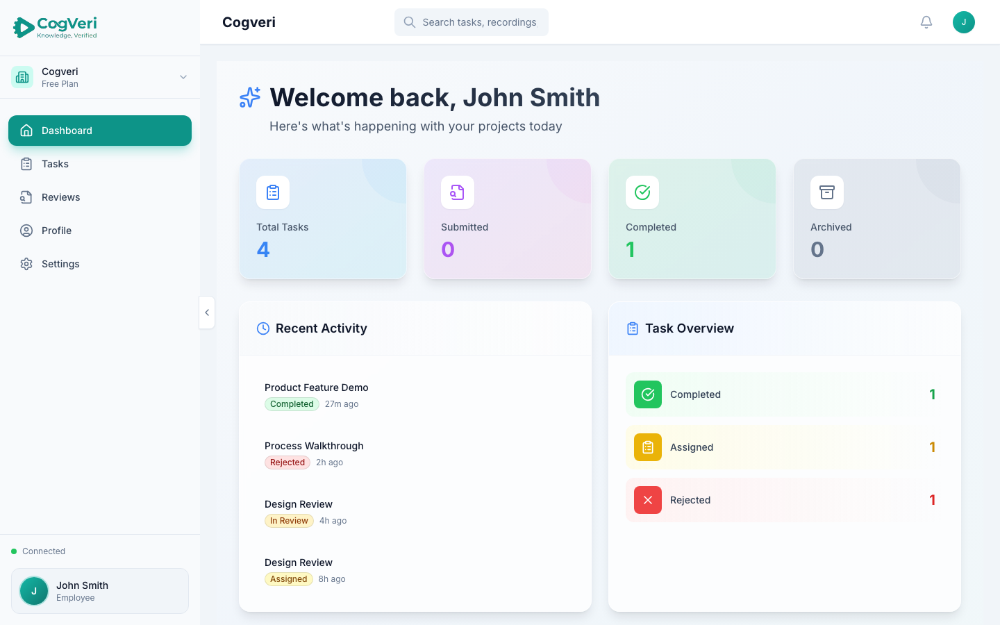
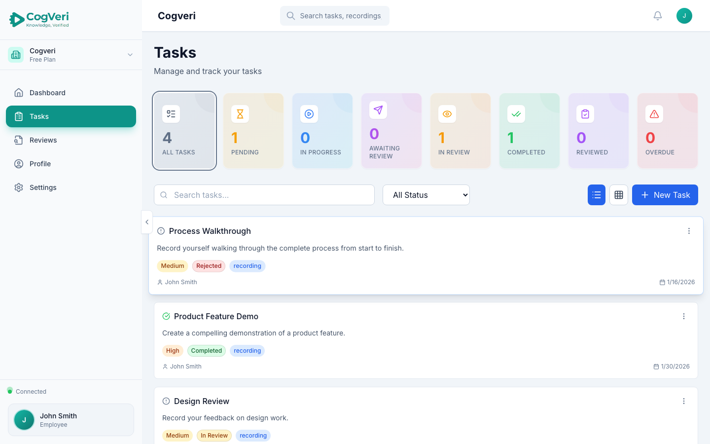
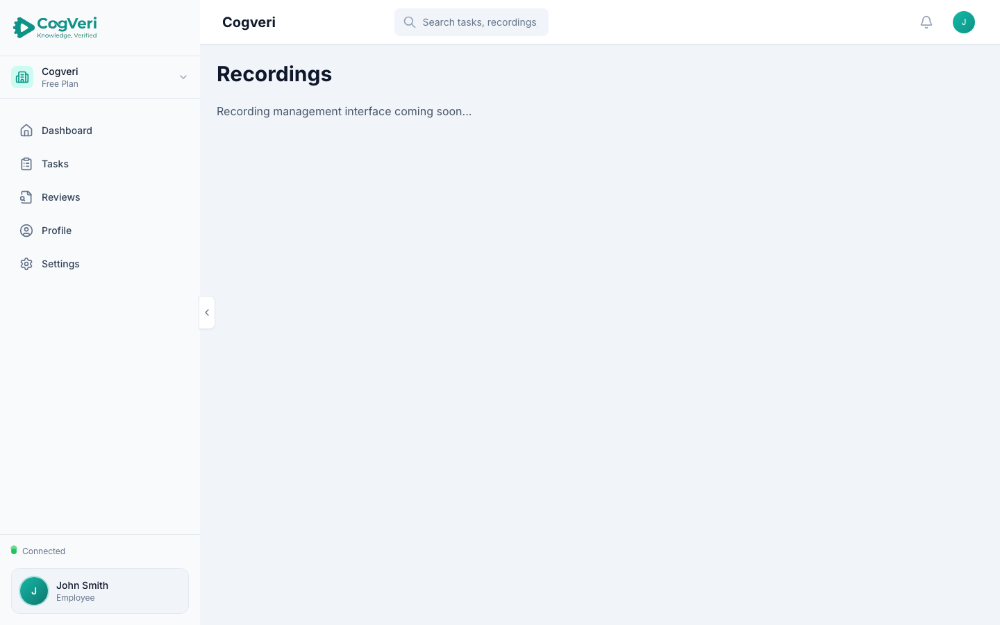
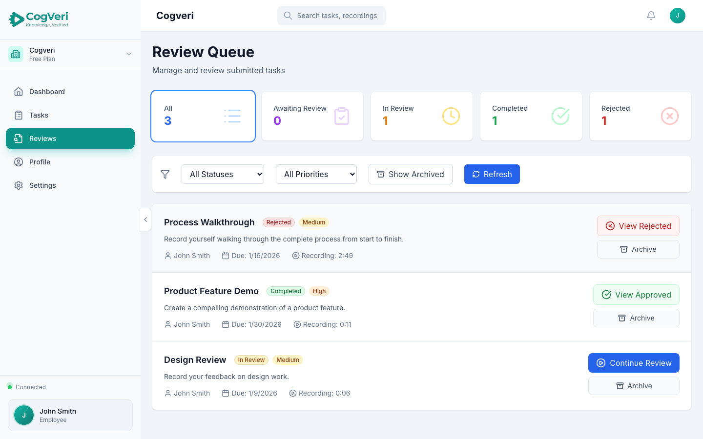
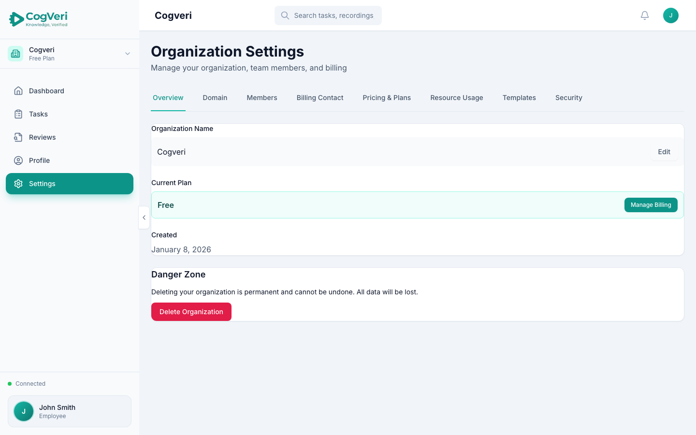

# CogVeri

[](https://github.com/ptstevens/CogVeri/actions/workflows/test.yml) [](https://github.com/ptstevens/CogVeri/actions/workflows/build.yml) [](https://github.com/ptstevens/CogVeri/actions/workflows/code-quality.yml)

**Knowledge, verified.** CogVeri is a multi-tenant SaaS platform for recording, transcribing, AI-analysing and reviewing task-based video assessments. An organisation sets a task, a contributor records their screen (no account needed via magic link), and the platform scores the recording against a rubric using speech and visual evidence before a human reviewer signs it off.



## What it does

```
Create task  ->  Assign internally or share by magic link  ->  Contributor records screen
                                                                        |
                                                   Chunked, resumable upload to object storage
                                                                        |
                                            Transcription (OpenAI Whisper, Python worker)
                                                                        |
                              AI analysis (Google Gemini: speech + visual evidence scored per rubric step)
                                                                        |
                                        Human review  ->  feedback  ->  re-record if needed
```

- **Tasks and templates.** Reusable task templates with pre-built rubrics, attempt tracking, bulk creation and statuses from pending through to completed.
- **Recording.** In-browser screen capture with a webcam overlay, multipart upload with resumable sessions, server-side duration probing and pre-signed playback URLs.
- **Transcription.** Whisper running in a separate Python worker, fed by a BullMQ queue.
- **AI analysis.** Gemini scores each rubric step from the transcript and extracted frames, with native video analysis for supported models and configurable prompts and passing thresholds. The same video always scores 100% against its own generated rubric, which is used as a calibration check.
- **Review.** Reviewer queue, structured feedback, human override of AI scores, and a loop back to the contributor.
- **Multi-tenancy.** Organisation-scoped data with roles (owner, admin, reviewer, member), PostgreSQL row-level security at the database layer, per-organisation storage buckets and domain verification.
- **Platform.** JWT auth with refresh rotation, magic links, Microsoft SSO, Stripe billing and trials, notifications, retention policies, audit logging, a system-admin console and API usage metrics.

More detail: [platform overview](docs/COGVERI_PLATFORM_OVERVIEW.md), [rubric and analysis system](docs/RUBRIC_AND_ANALYSIS_SYSTEM.md), [review agent](docs/REVIEW_AGENT.md).

## Architecture

Monorepo with three deployable parts and a shared test suite.

| Part             | Stack                                                                                   | Notes                                                                                                   |
| ---------------- | --------------------------------------------------------------------------------------- | ------------------------------------------------------------------------------------------------------- |
| `frontend/`      | React 18, TypeScript, Vite, Tailwind CSS, React Query, Socket.IO client                 | Lazy-loaded pages, API client with token refresh, Sentry                                                |
| `backend/`       | Node.js, TypeScript, Express, PostgreSQL (Knex), Redis, BullMQ, Socket.IO, Zod, Winston | REST routes, service layer, async queues for email, transcription, transcoding, thumbnails and analysis |
| `transcription/` | Python, OpenAI Whisper, Redis                                                           | Separate container, picks jobs from the queue                                                           |
| `tests/e2e/`     | Playwright                                                                              | Auth, magic links, tasks, reviews, organisations, API security, smoke                                   |

Infrastructure as deployed: frontend on Vercel, backend in Docker on a VPS, PostgreSQL 15, Redis 7, Cloudflare R2 for storage, Cloudflare DNS and CDN, Sentry for monitoring. See [DEPLOYMENT.md](DEPLOYMENT.md) and [docs/DEPLOYMENT_WORKFLOW.md](docs/DEPLOYMENT_WORKFLOW.md).

## Running it locally

Prerequisites: Node 18+, PostgreSQL, Redis, ffmpeg. Python 3.10+ if you want transcription running.

```bash
npm install

# backend/.env from backend/.env.example, frontend/.env from frontend/.env.example
# JWT_SECRET and JWT_REFRESH_SECRET are required; the app will not start without them

cd backend && npm run db:migrate && npm run db:seed && cd ..

npm run dev            # frontend on 5173, backend on 3000
```

Optional services: set `GOOGLE_AI_API_KEY` for Gemini analysis, `AWS_*` or `AWS_ENDPOINT_URL` for S3-compatible storage, and run the transcription worker with `cd transcription && pip install -r requirements.txt && python worker.py`.

## Tests and quality

```bash
npm run test           # backend and frontend unit tests (Vitest)
npm run test:e2e       # Playwright end-to-end, starts the dev servers itself
npm run lint
npm run type-check
```

GitHub Actions run tests, type checks and linting on every push and pull request, and build the Docker image for the backend.

## Screenshots

|                                                                |                                                           |
| -------------------------------------------------------------- | --------------------------------------------------------- |
|            |  |
|  |      |

## Status

Pre-release, and no longer in active development. I built CogVeri as a solo project in 2025 and 2026 and took it as far as a working end-to-end pipeline with test coverage and a deployment path. I paused further work after moving into a role whose employment terms include intellectual property assignment language that could reach personal projects, and I would rather not blur that line. The repository is published as a portfolio snapshot of the work at that point. All rights reserved.
